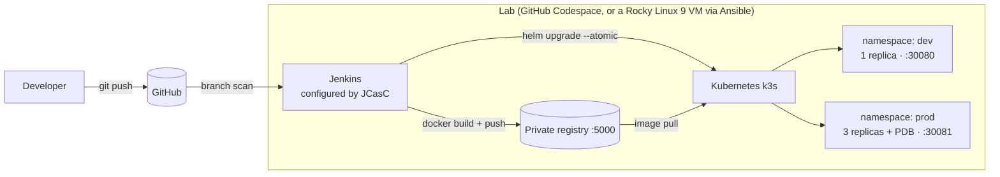
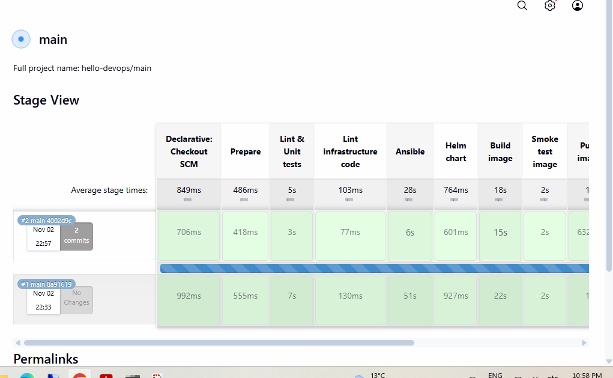
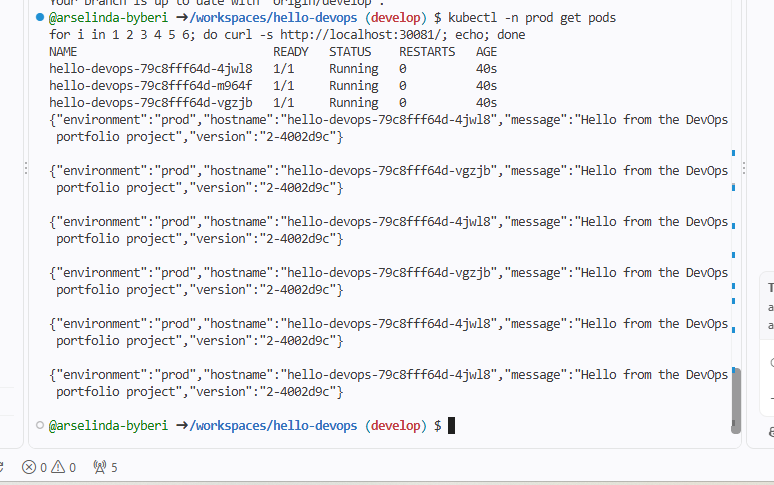
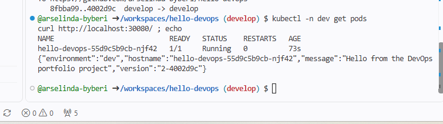
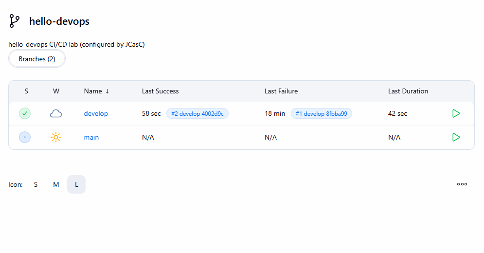

# hello-devops — End-to-end CI/CD lab

A small Python service taken all the way from `git push` to a running, health-checked
Kubernetes deployment, with every layer automated and defined as code:

| Layer | Tool | What it does here |
|---|---|---|
| Packaging | **Docker** | Multi-stage, non-root image with a healthcheck |
| CI/CD | **Jenkins** (Groovy pipeline) | Lint → test → lint infra code → build → smoke test → push → deploy, following **Git Flow** |
| Jenkins config | **JCasC** (Configuration as Code) | Jenkins itself is configured from `lab/jenkins/casc.yaml`, with no clicking through a wizard |
| Registry | **Docker Registry** | Private image registry; the pipeline never depends on Docker Hub |
| Orchestration | **Kubernetes** (k3s) | Runs the app with probes, resource limits and zero-downtime rolling updates |
| Release | **Helm** | One chart, separate values for `dev` and `prod`, automatic rollback on failure |
| Server provisioning | **Ansible** | Roles that turn a fresh **RHEL / Rocky Linux 9** host into the same stack (hardened OS, firewalld, SELinux enforcing). Linted in CI on every build. |
| Dev environment | **GitHub Codespaces** | The whole lab runs in the cloud on a free Codespace, defined in `.devcontainer/` |

## Architecture



## Proof it runs

**Jenkins pipeline**: every stage, from lint and tests to the approved production deploy:



**Production**: 3 replicas behind a Kubernetes Service; repeated requests are answered by different pods:



**Dev environment**: deployed automatically from `develop`; the version string is the Jenkins build number plus the commit hash:





## Branching model (Git Flow)

| Branch | Pipeline result |
|---|---|
| `feature/*` | Lint, unit tests, Ansible + Helm lint, image build, container smoke test. Nothing is deployed. |
| `develop` | All of the above, then the image is pushed and deployed to **dev** |
| `main` | All of the above, then a **manual approval** gate and a deploy to **prod** |

Every image is tagged `<build-number>-<commit-sha>`, so any running pod can be traced back
to the exact commit and Jenkins build that produced it.

---

## Run the lab in GitHub Codespaces (free, nothing to install)

### 1. Start the Codespace
On the repository page: **Code → Codespaces → Create codespace on develop**.
The first start takes about 5 minutes. It installs Docker, kubectl, Helm and k3d
(see `.devcontainer/devcontainer.json`).

### 2. Start the lab (about 5–10 minutes the first time)
In the Codespace terminal:
```bash
bash lab/up.sh
```
This creates the private registry and a k3s Kubernetes cluster (via k3d), builds a Jenkins
image with the needed tools and plugins, and starts Jenkins already configured through JCasC.
At the end it prints the Jenkins URL, user and password.

```bash
kubectl get nodes            # the cluster
docker ps                    # registry, cluster and Jenkins containers
```

### 3. Create the pipeline job in Jenkins
1. Open the **Ports** tab in the Codespace, then the globe icon next to **Jenkins (8080)**.
   Log in as `admin` with the printed password.
2. **New Item** → name `hello-devops` → **Multibranch Pipeline** → OK.
3. **Branch Sources → Add source → Git**. Repository URL: `https://github.com/<you>/hello-devops.git`
4. **Scan Multibranch Pipeline Triggers**: tick *Periodically if not otherwise run*, interval **1 minute**.
5. **Save**. Jenkins discovers `main` and `develop` and starts building.

### 4. Watch the whole flow work
```bash
# develop -> dev
git checkout develop
# change the message in app/app.py
git commit -am "Change greeting" && git push
# within a minute or two Jenkins deploys it:
curl http://localhost:30080/

# release to prod (Git Flow: develop -> main)
git checkout main && git merge develop && git push
# approve "Deploy to production?" in Jenkins, then:
curl http://localhost:30081/      # run it a few times: the hostname changes across 3 pods
kubectl -n prod get pods
```

### 5. Stop it when you're done
Codespaces stop by themselves after 30 minutes idle. To stop right away: on
github.com/codespaces, open **…** next to the Codespace and choose **Stop codespace**.
Next time, start it again and run `bash lab/up.sh`; everything continues where it was.

### Things to try (good interview stories)
- **Break a test** on a feature branch and see the pipeline stop before anything is built.
- **Break the readiness check** (make `/readyz` return 500) on `develop`. `helm --atomic`
  rolls the release back automatically, and the old version keeps serving.
- **Zero-downtime rollout:** run `while true; do curl -s localhost:30081/version; echo; sleep 0.5; done`
  during a prod deploy. With `maxUnavailable: 0` and readiness probes, no request fails.
- **Manual rollback:** `helm -n prod history hello-devops`, then `helm -n prod rollback hello-devops <rev>`.

---

## Alternative: a real Rocky Linux 9 server, provisioned by Ansible

`ansible/` contains roles that build the same stack on a RHEL-family host:
`common` (packages, chrony, firewalld, SELinux enforcing, SSH key-only), `docker`,
`registry` (systemd unit), `k3s`, `helm` and `jenkins`. The `Vagrantfile` creates a local
Rocky Linux 9 VM (6 GB RAM) and runs the playbook inside it:
```bash
vagrant up
```
Or against any existing Rocky/RHEL 9 VM, e.g. in the cloud:
```bash
cd ansible
ansible-galaxy collection install -r requirements.yml
ansible-playbook -i inventory/hosts.ini site.yml
```
The pipeline lints these roles with `ansible-lint` on every build. On a VM, set
`PUSH_REGISTRY`/`PULL_REGISTRY` in the `Jenkinsfile` to `localhost:5000` and give the smoke test a
user-defined Docker network.

---

## Design decisions

**Resource sizing.** The lab runs in 8 GB RAM / 2 vCPU: roughly 1–1.5 GB for Jenkins (JVM),
under 1 GB for k3s, about 1 GB for image builds and the registry, with the rest as headroom. Each
app pod requests 50m CPU / 64 Mi in dev and 100m / 96 Mi in prod, so 3 prod replicas reserve under
0.3 CPU and 300 Mi, and the scheduler can always place them.

**High availability.** In prod there are 3 replicas, a PodDisruptionBudget (`minAvailable: 2`),
a rolling update with `maxUnavailable: 0`, and liveness/readiness probes. This is a single-node
lab, so node-level HA is out of scope. In a real setup the next step is 3 control-plane nodes
(k3s embedded etcd, or OpenShift) behind a load balancer, with pod anti-affinity across nodes.

**Security.**
- The container runs as a non-root UID, with a read-only root filesystem, all Linux capabilities
  dropped and seccomp set to `RuntimeDefault`. These are the same constraints OpenShift enforces
  by default.
- Jenkins has no anonymous access. Its admin password is generated at start-up, passed in as an
  environment variable and never committed. Codespace ports are private to the owner by default.
- On the server path, SELinux stays enforcing, firewalld exposes only the needed ports and SSH
  accepts keys only.

**Why k3s and not OpenShift?** OpenShift needs 16 GB+ RAM even for a local install. k3s is a
certified Kubernetes distribution that fits in a small machine. The Helm chart and pod security
settings carry over to OpenShift unchanged.

## Repository layout
```
app/                 Python (Flask) service + pytest tests
Dockerfile           Multi-stage, non-root image
Jenkinsfile          Declarative Groovy pipeline (Git Flow aware)
helm/hello-devops/   Helm chart + values-dev.yaml / values-prod.yaml
lab/                 Codespaces lab: up.sh, down.sh, Jenkins image + JCasC config
.devcontainer/       Codespace definition (Docker, kubectl, Helm, k3d)
ansible/             Playbook + roles for a Rocky Linux 9 / RHEL 9 server
Vagrantfile          Local Rocky Linux 9 VM for the Ansible path
```

## Possible next steps
- Terraform for the VM itself (e.g. the `libvirt`, `openstack` or `vsphere` provider)
- Prometheus + Grafana via the `kube-prometheus-stack` Helm chart, with an alert on pod restarts
- Image vulnerability scanning with Trivy as a pipeline stage
