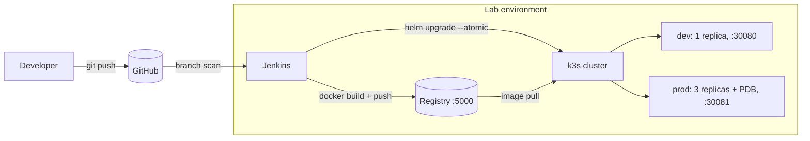

# hello-devops

A small Flask service with a complete CI/CD setup around it: Jenkins builds, tests and
packages it, and Helm deploys it to Kubernetes. Pushes to `develop` go to a dev namespace
automatically; merges to `main` go to prod after a manual approval.

Stack: Jenkins (declarative pipeline, JCasC), Docker, a private registry, Kubernetes (k3s),
Helm, Ansible, GitHub Codespaces.

## How it fits together



The lab runs in a GitHub Codespace: `lab/up.sh` starts the registry, a k3s cluster (via k3d)
and Jenkins as containers. The `ansible/` directory has roles that set up the same stack on a
Rocky Linux 9 / RHEL 9 server instead.

## Pipeline

The `Jenkinsfile` runs as a multibranch pipeline:

1. Lint (flake8) and unit tests (pytest)
2. `ansible-lint` on the Ansible roles and `helm lint` on the chart, in parallel
3. Build the image and smoke-test it (start the container, poll `/healthz`)
4. Push to the private registry (`develop` and `main` only)
5. Deploy with `helm upgrade --install --atomic`: `develop` to `dev`, `main` to `prod` after an
   approval step

| Branch | What happens |
|---|---|
| `feature/*` | Steps 1–3 only |
| `develop` | Steps 1–5, deploys to `dev` |
| `main` | Steps 1–5, waits for approval, deploys to `prod` |

Images are tagged `<build-number>-<short-sha>`, and the app returns that tag from `/version`,
so a running pod can be traced back to its build and commit.

## Screenshots

Pipeline on `main`, including the approval and prod deploy:


Prod: three pods, with requests spread across them:


Dev deployment after a push to `develop`:


## Running it

### Codespaces

1. Create a Codespace on `develop` (Code → Codespaces). The devcontainer installs Docker,
   kubectl, Helm and k3d.
2. Start the lab:
```bash
   bash lab/up.sh
```
   It prints the Jenkins URL and admin password at the end. The password is generated on first
   run and kept in `lab/.jenkins-admin-password` (git-ignored).
3. In Jenkins, create a Multibranch Pipeline with a Git branch source pointing at this repo,
   and set the scan trigger to 1 minute.
4. Push to `develop` and check `curl localhost:30080/`. Merge to `main`, approve the deploy,
   and check `curl localhost:30081/`.

`lab/down.sh` removes everything. Stopping the Codespace keeps the lab as it is; run
`bash lab/up.sh` again after restarting it.

### Rocky Linux 9 / RHEL 9 server

```bash
vagrant up                      # local VM, Ansible runs inside it
```
or, against an existing host:
```bash
cd ansible
ansible-galaxy collection install -r requirements.yml
ansible-playbook -i inventory/hosts.ini site.yml
```
Roles: `common` (packages, chrony, firewalld, SELinux enforcing, key-only SSH), `docker`,
`registry` (systemd unit), `k3s`, `helm`, `jenkins`. The `PUSH_REGISTRY`, `PULL_REGISTRY` and
`LAB_NETWORK` values at the top of the `Jenkinsfile` are specific to the Codespaces lab and need
adjusting for a VM. The roles are linted in CI but have not been run against a server in this
repo yet.

## Design notes

**Sizing.** The lab fits in 2 vCPU / 8 GB. Jenkins takes roughly 1–1.5 GB, k3s under 1 GB,
image builds and the registry about 1 GB. App pods request 50m CPU / 64Mi in dev and
100m / 96Mi in prod.

**Availability.** Prod runs 3 replicas with a PodDisruptionBudget (`minAvailable: 2`), rolling
updates with `maxUnavailable: 0`, and liveness/readiness probes. It is a single-node cluster,
so node failure isn't covered; that would need more nodes and pod anti-affinity.

**Security.** The container runs as a non-root UID with a read-only root filesystem, all
capabilities dropped and the `RuntimeDefault` seccomp profile, which also matches OpenShift's
default restrictions. Jenkins has no anonymous access and its password isn't committed.
Codespace ports are private. The Ansible roles keep SELinux enforcing, open only the needed
firewalld ports and disable SSH password login.

**k3s instead of OpenShift.** OpenShift needs much more memory than this environment has. The
chart and pod security settings are compatible with it.

## Rollback and failure tests

- A failing unit test stops the pipeline before an image is built.
- If `/readyz` fails after a deploy, `helm --atomic` rolls back to the previous release.
- `helm -n prod history hello-devops` and `helm -n prod rollback hello-devops <rev>` for a
  manual rollback.
- `while true; do curl -s localhost:30081/version; echo; sleep 0.5; done` during a prod deploy
  shows whether any requests fail during the rollout.

## Layout

```
app/                Flask app and tests
Dockerfile          multi-stage, non-root image
Jenkinsfile         pipeline
helm/hello-devops/  chart, values-dev.yaml, values-prod.yaml
lab/                Codespaces lab scripts, Jenkins image and JCasC config
.devcontainer/      Codespace definition
ansible/            playbook and roles for Rocky Linux / RHEL 9
Vagrantfile         local Rocky Linux 9 VM
docs/screenshots/   screenshots used above
```

## To do

- Terraform for provisioning the VM
- Prometheus and Grafana (kube-prometheus-stack)
- Trivy image scan in the pipeline