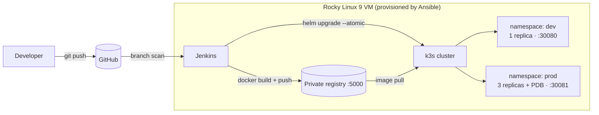

# hello-devops — End-to-end CI/CD lab on RHEL-family Linux

A small Python service taken all the way from `git push` to a running, health-checked
Kubernetes deployment, with every layer automated:

| Layer | Tool | What it does here |
|---|---|---|
| OS provisioning | **Ansible** | Turns a fresh Rocky Linux 9 VM into the full lab (hardened OS, firewalld, SELinux enforcing) |
| Virtualization | **Vagrant + VirtualBox/VMware** | Creates the VM reproducibly |
| Packaging | **Docker** | Multi-stage, non-root image with a healthcheck |
| Registry | **Docker Registry** | Private image registry, run as a systemd service |
| CI/CD | **Jenkins** (Groovy pipeline) | Lint → test → build → smoke test → push → deploy, following **Git Flow** |
| Orchestration | **Kubernetes (k3s)** | Runs the app with probes, resource limits and rolling updates |
| Release | **Helm** | One chart, separate values for `dev` and `prod`, automatic rollback on failure |

## Architecture



## Branching model (Git Flow)

| Branch | Pipeline result |
|---|---|
| `feature/*` | Lint, unit tests, image build, container smoke test. Nothing is deployed. |
| `develop` | All of the above, then the image is pushed and deployed to **dev** |
| `main` | All of the above, then a **manual approval** gate and a deploy to **prod** |

Every image is tagged `<build-number>-<commit-sha>`, so any running pod can be traced back
to the exact commit and Jenkins build that produced it.

---

## Step-by-step: build it yourself

### Prerequisites (on your laptop)
- [Git](https://git-scm.com/), [VirtualBox](https://www.virtualbox.org/) (or VMware Workstation), [Vagrant](https://developer.hashicorp.com/vagrant/install)
- A GitHub account
- Optional: Docker Desktop and Python 3.12 for running things locally

### 1. Run the app locally (5 minutes)
```bash
cd app
python -m venv .venv && source .venv/bin/activate   # Windows: .venv\Scripts\activate
pip install -r requirements-dev.txt
pytest -v
python app.py          # open http://localhost:8080
```

With Docker:
```bash
docker build -t hello-devops:local .
docker run --rm -p 8080:8080 hello-devops:local
curl http://localhost:8080/healthz
```

### 2. Push it to GitHub with a Git Flow structure
```bash
git init && git add . && git commit -m "Initial commit: app, pipeline, Ansible, Helm"
git branch -M main
git remote add origin https://github.com/<you>/hello-devops.git
git push -u origin main
git checkout -b develop && git push -u origin develop
```

### 3. Create and provision the server (about 15–20 minutes)
```bash
vagrant up
```
Vagrant creates a Rocky Linux 9 VM at `192.168.56.10` and runs the Ansible playbook inside
it. At the end, Ansible prints the Jenkins URL and the initial admin password.

Re-running the provisioning is safe because the playbook is idempotent:
```bash
vagrant provision
```

> **Using your own VM instead of Vagrant?** Install Ansible on Linux or WSL, put the VM's IP
> and user in `ansible/inventory/hosts.ini`, then:
> `cd ansible && ansible-galaxy collection install -r requirements.yml && ansible-playbook site.yml`

Check the cluster:
```bash
vagrant ssh
sudo kubectl get nodes
systemctl status jenkins registry k3s
```

### 4. Set up Jenkins (10 minutes)
1. Open `http://192.168.56.10:8080` and paste the initial admin password.
2. Choose **Install suggested plugins**, then also install **Docker Pipeline**
   (Manage Jenkins → Plugins).
3. Create the job: **New Item → Multibranch Pipeline**.
   - Branch source: **GitHub**, with your repo URL. A public repo needs no credentials.
   - Scan triggers: **Periodically, if not otherwise run → 1 minute**.
     GitHub webhooks can't reach a private VM IP, so polling stands in for them.
4. Save. Jenkins discovers `main` and `develop` and starts building.

### 5. Watch the whole flow work
```bash
# develop -> dev
git checkout develop
# change the message in app/app.py
git commit -am "Change greeting" && git push
# Jenkins deploys to dev within a minute or two:
curl http://192.168.56.10:30080/

# release to prod (Git Flow: develop -> main)
git checkout main && git merge develop && git push
# approve the "Deploy to production?" step in Jenkins, then:
curl http://192.168.56.10:30081/      # call it several times: the hostname changes across 3 pods
```

### 6. Things to try (good interview stories)
- **Break a test** on a feature branch and see the pipeline stop before anything is built.
- **Break the healthcheck** (e.g. make `/readyz` return 500) on `develop`. `helm --atomic`
  rolls the release back automatically, and the old version keeps serving.
- **Zero-downtime rollout:** run `while true; do curl -s :30081/version; sleep 0.5; done`
  while a prod deploy happens. `maxUnavailable: 0` + readiness probes = no failed requests.
- **Manual rollback:** `helm -n prod history hello-devops` then `helm -n prod rollback hello-devops <rev>`.
- **Drain test:** the PodDisruptionBudget keeps at least 2 prod pods running during maintenance.

---

## Design decisions

**Resource sizing.** The VM gets 6 GB RAM / 2 vCPU: roughly 1 GB for k3s, 1–1.5 GB for
Jenkins (JVM), about 1 GB for Docker builds and the registry, and 0.5 GB for the OS, with
the rest as headroom. Each app pod requests 50m CPU / 64 Mi in dev and 100m / 96 Mi in prod,
so 3 prod replicas reserve under 0.3 CPU and 300 Mi, and the scheduler can always place them.

**High availability.** In prod there are 3 replicas, a PodDisruptionBudget (`minAvailable: 2`),
a rolling update with `maxUnavailable: 0`, and liveness/readiness probes. This is a single-node
lab, so node-level HA is out of scope. In a real setup the next step is 3 server nodes
(k3s embedded etcd, or OpenShift) behind a load balancer, with pod anti-affinity across nodes.

**Security.**
- SELinux stays enforcing and firewalld exposes only the ports that are needed.
- SSH accepts keys only, no passwords.
- The container runs as a non-root UID, with a read-only root filesystem, all Linux
  capabilities dropped and seccomp set to `RuntimeDefault`. These are the same constraints
  OpenShift enforces by default.
- The registry listens on localhost only.

**Why k3s and not OpenShift?** OpenShift needs 16 GB+ RAM for even a local install (CRC). k3s
is a certified Kubernetes distribution that fits on a laptop. The Helm chart and pod security
settings carry over to OpenShift unchanged.

## Repository layout
```
app/                 Python (Flask) service + pytest tests
Dockerfile           Multi-stage, non-root image
Jenkinsfile          Declarative Groovy pipeline (Git Flow aware)
helm/hello-devops/   Helm chart + values-dev.yaml / values-prod.yaml
ansible/             Playbook + roles: common, docker, registry, k3s, helm, jenkins
Vagrantfile          Rocky Linux 9 VM definition
```

## Possible next steps
- Terraform for the VM itself (e.g. the `libvirt` or `vsphere` provider)
- Prometheus + Grafana via the `kube-prometheus-stack` Helm chart, with an alert on pod restarts
- Image vulnerability scanning with Trivy as a pipeline stage
